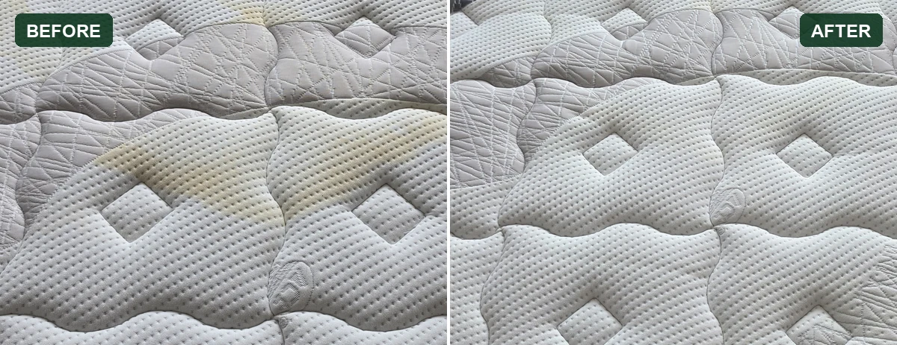
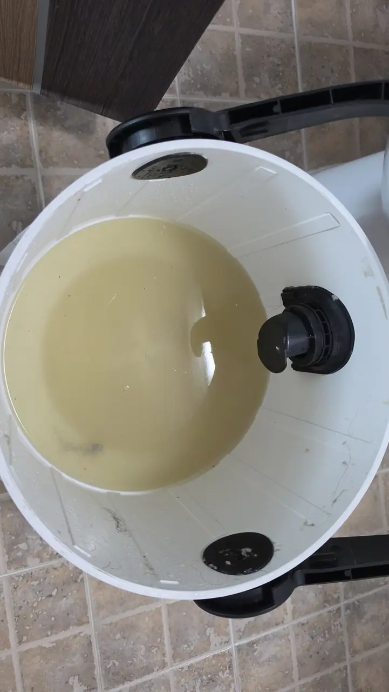
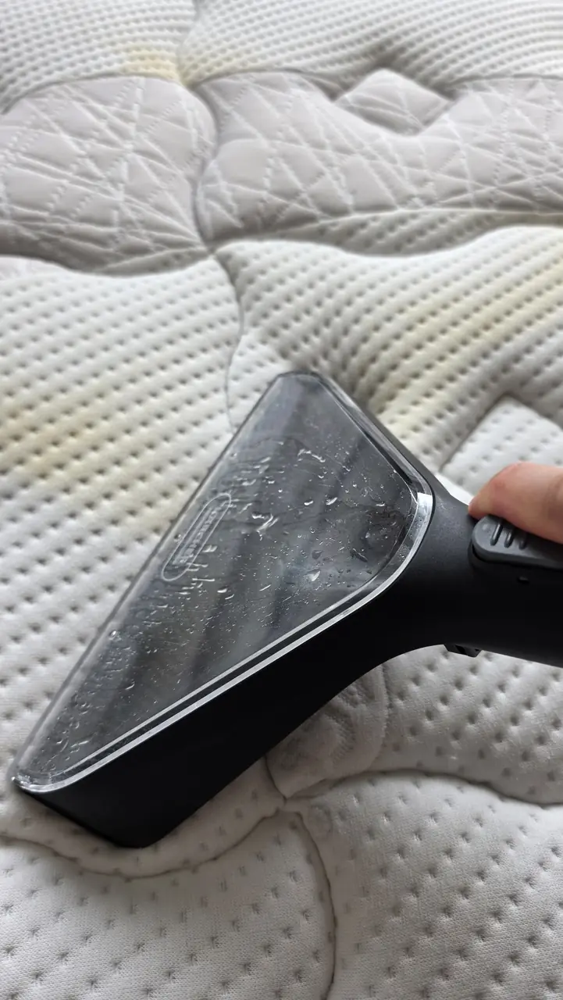
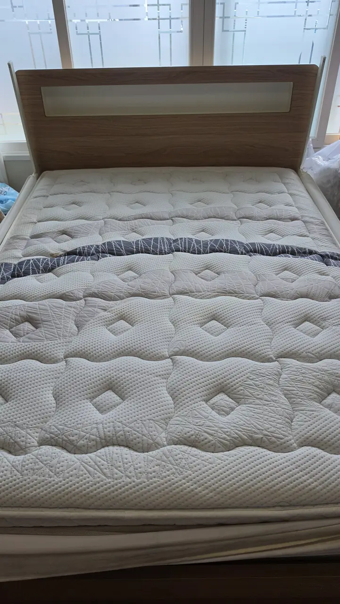
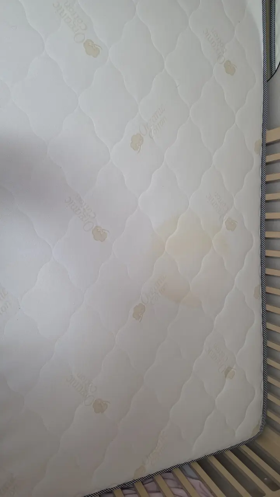

A child in the flat had an accident at night, and nobody caught it in
time. By the time anyone looked properly it was not a wet patch any more.
It was a yellow map across the middle of a double mattress, dried in and
spread sideways through the quilting.

We bought a machine and did it ourselves. It worked. It was also several
times harder than it looks in anybody's before-and-after photo, and the
part that costs you the most — the drying — has no shortcut at all.

This is the hands-on companion to
[sofa and mattress cleaning in Korea](/blog/sofa-mattress-cleaning-korea/),
which covers what the service costs and how to book it. **That post is about
hiring somebody. This one is about what you take on if you don't.**

## What a dried accident actually looks like

*The same patch of quilting, ninety minutes apart · ⓒ @BalliBalliSeoul*

**The yellow border is the most useful thing in the left-hand frame.** Urine does not
sit on the surface. It goes down into the fill and travels outwards until it
runs out, and the brown-yellow line you end up staring at is the outline of
where it stopped. Everything inside that line is the actual job.

Which is why wiping it fails. The top centimetre was never the problem, and
in a Korean summer whatever is left deeper down comes back to life with the
humidity — the reason the smell returns in July even after the stain stops
looking bad.

## The machine, and what it is actually doing

We used a **Kärcher SE 4**. It is a spray-extraction cleaner, not a steam
cleaner and not a vacuum: it sprays water and detergent into the fabric and
sucks it straight back out in the same pass. That is the same principle as
the machine a professional crew arrives with, at a smaller scale.

<figure style="margin:22px auto 0;max-width:360px">
  <video src="/video/mattress-extraction-nozzle-window.mp4" poster="/video/mattress-extraction-nozzle-window-poster.webp" width="480" height="854" autoplay muted loop playsinline controls preload="metadata" style="display:block;width:100%;height:auto;border-radius:12px;background:#000"></video>
  <figcaption style="text-align:center;font-size:12.5px;color:var(--muted);margin-top:8px">Sixteen seconds of one pass — water and fibre moving through the window · ⓒ @BalliBalliSeoul</figcaption>
</figure>

**The clear window in the nozzle head is not decoration.** It is the only
live feedback you get. You watch the water change colour as you pull, and
when it stops changing, that pass is finished and you move along. Working
without looking at it is how people soak a mattress and achieve nothing.

## The detergent is the part people get wrong

The machine takes **Kärcher RM 519**, the maker's own carpet and upholstery
detergent, which fits the whole SE line from the SE 2 up to the SE 6.

**Do not put laundry liquid, dish soap or shampoo in the tank.** This is the
single rule worth carrying away from this post, and the reason is foam.

Here is the evidence, because it is better than the usual forum advice:
Kärcher sells a **separate product called Foam Blocker (RM 761)** whose only
job is to go into the waste-water tank of spray-extraction machines, scrubber
dryers and wet vacuums. The maker's own description says it lets the tank
fill properly without the float tripping early **and without damaging the
suction turbine**. That is Kärcher telling you, in a product listing, that
foam reaching the motor is a real way to kill one of these machines.

**What we could not find is a line in the SE 4 manual saying "low-foam
only."** So take the rule at the level the evidence actually supports it: use
the detergent that was made for the machine, and keep the kitchen out of the
tank.

What Kärcher publishes for RM 519 itself:

| | |
| --- | --- |
| **Dose** | 100–200 ml of detergent per 4 litres of water, more for heavier soiling |
| **Water temperature** | Under 50 °C |
| **Heavy soiling** | Pre-spray, leave it 5 minutes to work, then vacuum off |
| **Afterwards** | Do not rinse |
| **Before you start** | Check the fabric is colourfast |
| **Absorbent fabrics (wool)** | Vacuum a second time |

*Kärcher product information for RM 519. Checked 26 October 2026 — verify
against the sheet in your own box, since dosing differs by product and by
market.*

The five-minute dwell is the instruction people skip, and it is the one that
does the work on a set-in stain. Spray, walk away, come back, extract.

## The proof is in the tank, not on the mattress

*One tank, from one mattress · ⓒ @BalliBalliSeoul*

That is not surface dirt. It is what was sitting inside the quilting, and it
is the only honest measure of whether the pass did anything.

**If your waste tank comes back more or less clear, you are not reaching
anything** — either the solution is not getting down far enough, or you are
extracting before it has had time to lift anything, or the nozzle is not being
pressed in hard enough. Change one of those three things rather than doing
another twenty passes.

## Nobody tells you how hard this is

The listings sell you a machine that does the work. It does one part of the
work. You do the rest, and the rest is most of it.

A single double mattress took ninety minutes of unbroken work — the gap
between the first photo here and the last. You cannot stand up to it — you are kneeling on the bed, leaning across, dragging a hose and a
tank behind you, and a mattress is wider than your arms are long, so half of
it is done from an awkward angle. Then you empty the waste tank, refill the
clean one, and start again.

*Several light passes beat one soaking, every time · ⓒ @BalliBalliSeoul*

Three things we would tell anyone starting:

**Blot first, never scrub.** Scrubbing drives the stain deeper and frays the
quilting stitching.

**Work from the outside of the stain inwards.** Push from the middle and you
widen the edge you were trying to remove.

**Several light passes, not one soaking.** The machine can only pull back what
it put in. Put in more than it can recover and you have simply moved water
into the foam, which is the next section's problem.

## Drying is half the job, and it has no shortcut

**Plan on 8 to 12 hours before bedding goes back on.** That was our
experience and it is the number we would give anyone asking. A mattress is
not a towel: the surface feels dry long before the fill is, and sealing a
damp core under a fitted sheet in a Korean autumn is how you turn a stain
problem into a mould problem.

What actually sped it up:

| Lever | Why it works |
| --- | --- |
| **Aircon on 제습 (dehumidify), not 냉방 (cooling)** | Cooling drops the air temperature. Dehumidify pulls water *out* of the air, which gives the mattress somewhere to send its own moisture. A cold room at 80% humidity dries nothing |
| **A fan pointed at the surface** | Moving air clears the saturated layer sitting on the fabric. A fan on its own is slow; a fan plus 제습 is noticeably not |
| **Bedding off, covers back** | Do not remake the bed, not even loosely. Leave the whole surface open |
| **Stand it up if you can** | Air on both faces roughly halves it. On a heavy double in a small room this is often not realistic, and that is fine |

Most Korean wall units have 제습 on the remote as a separate mode, and this is
exactly the job it is for. If you have had damp trouble in the flat before,
the same logic is the whole of
[mould behind the baseboard](/blog/mould-behind-baseboard-korea/) — and if
the unit itself smells when you run it, that is a different job, covered in
[aircon cleaning](/blog/aircon-cleaning-korea/).

**Look again the next morning.** As a mattress dries, whatever is still deeper
down wicks back up to the surface, so a stain that looked finished in the
evening can reappear faintly by breakfast. A second pass on the dry mattress
is normal, not a failure.

## What it looks like afterwards

*Straight after the last pass — a faint shadow still where the worst of it was, and twelve hours of drying to go · ⓒ @BalliBalliSeoul*

Honestly: it is dramatically better, there is no smell, and the room feels
different. It is not a new mattress. Dried urine that has been in the fibres
for a while has already taken some of the colour with it, and a domestic
machine lifts most of that rather than all of it.

That gap — most rather than all — is the gap you are paying a professional to
close, and it is worth knowing which one you are buying before you start.

## While you have it out, do the other one

*The other mattress in the house, waiting its turn · ⓒ @BalliBalliSeoul*

The tank is already dirty and the solution is already mixed. The marginal cost
of the second mattress is an hour and a refill, and every household with a
small child has a second one.

## If there is a small child in the flat, buy the cover first

A **방수 매트리스 커버 (bangsu maeteuriseu keobeo)** — a waterproof mattress
protector — costs around ₩20,000, goes in the washing machine, and makes
everything above unnecessary. It is the cheapest item in this article and by
some distance the highest-return one. The rest of the between-cleans routine
is in the
[sofa and mattress post](/blog/sofa-mattress-cleaning-korea/#between-cleans).

Buy it before the accident, not after. That is the entire advice.

## Buy the machine, rent one, or call somebody

  

    <strong style="color:var(--fg)">Spray-extraction machines on Coupang.</strong> The <strong style="color:var(--fg)">first two are purchases</strong> — the Kärcher SE 4 is the machine in the photos above, and the Bissell SpotClean C5 is the smaller, lighter household version. The <strong style="color:var(--fg)">last two are rentals</strong>, which is usually the right answer for one accident rather than a habit; the Bissell Professional on the right is a three-day hire with delivery and collection included. All four do the same thing: put solution in, pull it back out.
  

  

    
    
    
    
  

  

    Affiliate links — we earn a small commission if you buy or rent through them, at no extra cost to you. 
    이 포스팅은 쿠팡 파트너스 활동의 일환으로, 이에 따른 일정액의 수수료를 제공받습니다.
  

**If you rent, stay inside the rental terms.** Read them before the box
arrives, not after: how many days you have, when the collection is booked for,
what counts as damage, and what has to be emptied, rinsed and dried before it
goes back. A rental kept an extra day or returned with water still in the tank
stops being the cheap option.

**And buying is only cheap if you will use it twice.** With a small child, a
pet or a fabric sofa that gets sat on, you will. For one accident, hire it —
or skip both and have somebody else kneel on the bed for an hour and a half.

## When to call somebody instead

The honest list, after doing it:

- **The stain is older than a few months and large.** A crew's machine has
  more suction and hotter water, and the gap between "most of it" and "all of
  it" is exactly where that shows
- **You cannot get the room dry.** No aircon, no fan, wet season, north-facing
  room — a half-dried mattress is worse than a stained one
- **It is a smell rather than a mark**, which usually means the core, not the
  cover
- **It is the landlord's mattress**, in which case the conversation about who
  pays happens before anyone cleans anything
- **Your back, your knees, or your weekend say no.** This is a legitimate
  reason and we are not going to pretend otherwise

Prices for the booked version — per item, by size and condition — are in
[sofa and mattress cleaning in Korea](/blog/sofa-mattress-cleaning-korea/#what-it-costs),
and where upholstery sits among the Korean cleaning categories is in
[deep cleaning](/blog/deep-clean-korea-sorting-first/).

> **Not sure whether yours is worth cleaning or replacing?** Send a photo on
> [KakaoTalk](https://pf.kakao.com/_RJxhSX/chat) — or
> [WhatsApp](https://wa.me/821075191282) — and tell us how old the stain is.
> We will tell you honestly which of the three it is: **a weekend with a
> rented machine, a job for a crew, or a mattress that has had its life.**
> Asking costs nothing.

## Get it sorted

Buy the waterproof cover today, whatever else you decide. If the mattress
already needs the work, rent the machine for one stain and buy one only if
you will reach for it again — and give the drying the twelve hours it wants,
because that is the half of the job that cannot be rushed and the half that
ruins the result when it is.

If the Korean side is what is stopping you — ringing a cleaning company,
describing the stain, agreeing a price per item before anyone arrives — that
is the part we arrange in English. We are an intermediary, not the crew: we
book it, we hold the conversation in Korean, and the quote is agreed with you
in the chat before anyone comes to the door. The
[cleaning page](/cleaning) covers the rest of the house.

## Corrections

We log changes here rather than editing quietly, so you can see what we
got wrong and when.

| Date | What changed |
| ---- | ------------ |
| **26 October 2026** | **How long the job took, and one line about 제습.** The first version said the mattress "took the better part of a morning" and later that you could "kneel on the bed for three hours". Our own photographs are timestamped 11:02 and 12:31, so the figure is ninety minutes and both lines now say so. The same version called 제습 "the one week of the year it earns its place" — the dehumidify mode is not a one-week-a-year setting, and the claim has been removed. |
