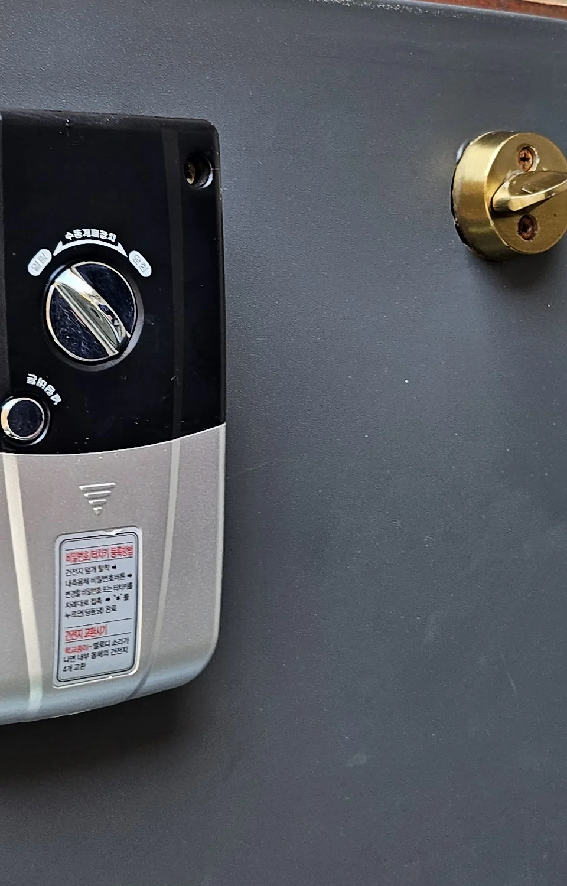
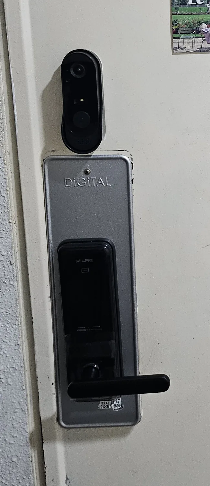

Your keypad still lights up. The buttons still work. And it is
beeping at you — in your hallway, at eleven at night, in a language
you do not read.

The good news is that the most common cause is not a fault at all,
and it stops the moment you do one thing.

## Start here: is the door actually shut?

**The single most common beep in a Korean flat is a burglar
warning, and nothing is broken.**

Korean smart locks watch the door. If it was not pulled fully
closed and then swings open — a draught, a bag knocking it, a
delivery that did not latch it — the lock treats that as someone
having got in. So it makes a noise. That is the whole design.

**Punch in your code and it stops.** Then close the door properly
and check it caught. No batteries, no locksmith, no management
office.

If you live somewhere with heavy fire doors or a strong stairwell
draught, this will happen to you more than once. It is worth
knowing before you spend an evening looking up locksmiths.

## You typed the right code and nothing happened

Not every failure makes a sound, and the silent one is the one people
waste an evening on. The lock lights up. It takes your code. Then
nothing — no beep, no error, no motor. It looks exactly like a dead
lock, so everybody goes and buys a battery.

**It is usually the door, not the lock.** The bolt is pinched between
the door and the frame and cannot slide back, so the motor turns
against something it cannot move.

**To get in right now:** put your hand flat on the door and push it
firmly toward the frame — or pull it toward you — while you enter the
code. Take the weight off the bolt and it frees the moment the motor
turns.

That gets you through the door tonight. It does not fix anything —
[the latch is fighting the frame](#3-the-latch-is-fighting-the-frame)
below is why, and what the repair is.

## The four things a beep usually means

Once the door is definitely shut and it is *still* beeping, you are
in one of four situations.

### 1. The battery is going

A repeating chirp every time you use the lock, or at intervals on
its own, is the standard low-power warning. It is a warning, not a
failure — the lock is telling you that you have days, not weeks.

**Deal with it now rather than at 2 a.m.** A lock that dies
completely is a different and much worse evening, and we have
written that one up separately:
[what to do when the keypad is dead](/blog/keypad-door-lock-dead-locked-out-seoul/).

Replacing them is a two-minute job:

- **Open the cover on the inside panel** — the unit on the room side
  of the door. It usually slides up, or off towards you
- **Read the sticker before you go shopping.** Korean locks print
  the answer on the inside panel. The one below says
  **건전지 4개 교환** — *replace the four batteries* — right under a
  line about the noise it makes when they are going. Yours may say a
  different number. Take a photo of it and buy accordingly

*The sticker under the turn knob: how to set a code, and — in red — 건전지 교환시기, when to change the batteries · ⓒ @BalliBalliSeoul*

That silver section is the battery cover. The dial above it is the
**수동개폐장치**, the manual turn — it locks and unlocks the door by
hand whatever the electronics are doing, which is worth knowing
about before you need it.

- **Replace every one of them at once**, with the same type. Do not
  mix a fresh battery with an old one, and do not mix brands or
  types — the lock reads the whole set as one supply, and one weak
  cell drags the rest down
- **Convenience stores sell batteries and are open all night.** GS25,
  CU and 7-Eleven all carry AA. They are dearer than a supermarket
  and it does not matter at midnight —
  [how the stores work](/blog/korean-convenience-store-guide/) if
  you have not used one yet
- **Daiso is the cheap option** in daylight hours

### 2. You got the code wrong too many times

Enter a wrong PIN several times in a row and the lock will beep and
then refuse to listen for a while. This is deliberate — it is what
stops someone standing at your door trying combinations.

**Wait it out.** The lockout clears itself after a short period.
Hammering more numbers in resets the clock and gets you nowhere.

### 3. The latch is fighting the frame

If the lock lights up, accepts your code, and then grinds, beeps, or
does nothing at all, the motor is struggling against the door rather
than failing electrically. **The silent version of this is the one that
fools people** — no warning noise, no error, just a lock that takes the
right code and leaves you standing there. It looks like a dead lock. It
is a stuck door.

Push-and-pull gets you through it tonight. What follows is why it is
happening and what actually stops it.

Test it with the door **open**: work the lock and watch the bolt
slide in and out. If it moves freely with the door open but jams
when the door is closed, the bolt is no longer meeting its hole
squarely — the door has dropped on its hinges, or the frame has
moved.

That is a real repair, not a battery. Keep using it in that state
and you will eventually be locked out at the worst moment, because
a motor that has been straining is a motor about to give up.

### 4. Water got in

Korea's summer does this. In a flat where the front door faces an
open corridor, monsoon rain and the humidity that comes with it
reach the outside panel — the same damp that
[shows up behind your skirting boards](/blog/mould-behind-baseboard-korea/)
gets into electronics too. A touch keypad that has taken
on moisture registers presses nobody made, and beeps about them.

**Dry the panel with a soft cloth and give it time.** If it is still
misbehaving once genuinely dry, it needs looking at rather than
waiting.

## Counting the beeps will not get you far

You will find advice telling you that three beeps means one thing
and five means another. **Be careful with it.** Korean locks come
from several manufacturers — Gateman, Samsung, EZON, Milre and
others — and they do not share a code. A pattern that means low
battery on one brand means something else on the next.

**Find the brand name on the lock itself**, on the outside panel or
inside the battery cover, before you trust any beep-counting chart.
That name is what makes a search useful.

*Moulded into the panel rather than printed — easy to miss, and it is the one word worth having · ⓒ @BalliBalliSeoul*

It is usually moulded into the plastic rather than printed, so it is
easy to walk past for years without noticing it is there.

## When to stop and call someone

Some of this is a ten-second fix. Some of it is not, and knowing
which is which saves you money.

**Handle it yourself:** a burglar warning after the door swung open,
a low-battery chirp, a wrong-code lockout, a damp panel that dries
out and behaves.

**Get someone in:** a bolt that binds against the frame, a lock that
beeps and refuses a code you know is right, visible damage to the
panel, or anything that has already left you standing outside once.

**If you are in a flat with a management office, try them first.**
The 관리사무소 in most Korean apartment buildings deals with door
locks constantly and will often send someone up for nothing, or tell
you which shop the building uses. Officetels usually have the same
arrangement at the front desk. The wider map of which trade owns which problem — and what the office covers free — is in [who to call for what in a Korean flat](/blog/english-speaking-handyman-seoul/).

## Renting? Ask before you pay for it

Worth settling early, because it comes up: a digital lock is
normally treated as part of the flat's fittings, while the batteries
in it are treated as something you use up — the way a light bulb is.

That is the usual understanding rather than a rule, and it can be
written differently in your contract. **Ask the landlord or the
management office before you pay a locksmith yourself**, especially
if the lock is failing rather than flat. Getting the answer
afterwards is a much harder conversation. It belongs with the other
things worth
[checking before you sign](/blog/what-to-check-before-renting-seoul/).

## The Korean part

The lock will tell you what is wrong in Korean, or in beeps, and
neither is much help at midnight. The manual is Korean. The brand's
service line is Korean. The locksmith who answers is Korean.

> **Send us a photo of the lock and tell us what noise it is
> making.** Our [locksmith service arranged in English](/locksmith)
> will tell you whether this is a battery, a hinge or a call-out —
> and if it is a call-out, we make it and stay on the line. Message
> us on [WhatsApp](https://wa.me/821075191282) or
> [KakaoTalk](https://pf.kakao.com/_RJxhSX/chat).

## Get it sorted

The one-line version: **if it started beeping after the door came
open, punch in your code and it stops. If it is chirping on its own,
change every battery at once tonight rather than at 2 a.m. If it
takes your code and then grinds, the problem is the door, not the
lock — and that one needs a person.**
