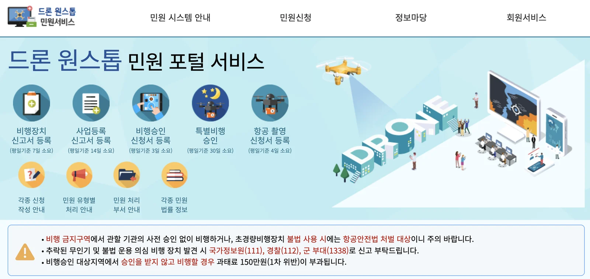

You packed the drone. You pictured the shot — the palace roofs, the Han River
at dusk, Bukhansan from above. And then somebody told you that you cannot fly
it in Seoul, and you could not work out whether they were right.

They were mostly right, and the reason is not what most people assume.

**This page is not legal advice and it is not permission.** It is the shape of
the system, the words you will need, and the one website that actually decides
things — so that you can check your own case before you travel rather than
after you have been stopped.

## Why is so much of Seoul closed to drones?

Korea is a country with an active security situation, and its airspace rules
reflect that rather than a dislike of hobbyists.

The restrictions stack. There is airspace closed because of **national
security and military installations**, airspace closed around **airports and
airfields**, and rules that apply **anywhere** — not over crowds, not at
night, not when you cannot see the aircraft with your own eyes.

Seoul sits under several of those at once. The city government's own guidance
to residents is blunt about it: **Seoul and the surrounding metropolitan area
are restricted or prohibited airspace**, and anybody wanting to fly is told to
apply through the national portal rather than to assume.

**So the working assumption for a visitor should be the opposite of the one
you are used to.** In much of Europe or North America you may fly unless a map
says otherwise. Here, in and around Seoul, assume you may not, and find out
whether your specific spot and date are an exception.

## What does your drone's weight decide?

Two things, at two different thresholds, and they are easy to confuse because
most countries only have one.

| Maximum take-off weight | Pilot certificate | Register the aircraft |
|---|---|---|
| **250g or under** | **No** — treated as a toy | No |
| **Over 250g to 2kg** | **Class 4** (4종) | No |
| **Over 2kg to 7kg** | Class 3 (3종) | **Yes** |
| **Over 7kg to 25kg** | Class 2 (2종) | Yes |
| **Over 25kg** | Class 1 (1종) | Yes |

**250g is the certificate line. 2kg is the registration line.** A drone of
1.5kg needs a Class 4 certificate but no registration; one of 3kg needs both.

Class 4 is the lightest requirement and the one most travel drones fall into:
**from age 10, with an e-learning course** run by the Korea Transportation
Safety Authority. The classes above it need that authority's own certificate
and a minimum age of 14.

**And one rule that overrides the whole table: if the flying is commercial,
the aircraft must be registered whatever it weighs.** "Commercial" here means
flying for somebody else, for payment — the obvious case being paid
photography. Filming your own trip is not that. Filming somebody's wedding for
a fee is.

**This is why the sub-250g category exists at all.** A good deal of consumer
drone design has been aimed at sitting just under that line, here and
elsewhere. Check your own model's figure with the battery you actually fly —
it is the take-off weight that counts, not the body.

### What it costs to get this wrong

The penalties are not uniform, and the worst of them is not a fine.

| | |
|---|---|
| **Flying without the required certificate** | Up to **₩4,000,000** (항공안전법 §166②) — and where the airframe also lacked safety certification, up to a year's imprisonment or ₩10,000,000 (§161②) |
| **Flying an unregistered aircraft that needed registering** | **Up to six months' imprisonment or a ₩5,000,000 fine** (§161③). This is a criminal penalty, not an administrative one |
| **No registration number displayed** | Up to ₩1,000,000 |
| **Flying in approval-required airspace without approval** | **₩1,500,000 for a first offence**, per the portal's own notice |

**Being under 250g exempts you from the certificate. It exempts you from
nothing else.** Weight and airspace are separate questions, and the second one
is what ends most Seoul plans.

## Flight approval and filming approval are two different things

This is the single most useful thing on this page, and it is where people who
have read an old article go wrong.

| | **비행승인** — flight approval | **항공촬영** — aerial filming |
|---|---|---|
| What it covers | Being in the air at all | Recording while you are there |
| Whose rules | Ministry of Land, Infrastructure and Transport | Ministry of National Defense guidance |
| In prohibited airspace | The controlling authority — Joint Chiefs, Capital Defense Command, Air Force — approves separately | Same |

**Neither one substitutes for the other.** Permission to film is not
permission to fly, and permission to fly is not permission to film. The
official guidance says so explicitly, because the mistake is common.

### The part that changed, and that old articles get wrong

If you find an English or Korean article from a few years back, it will
probably tell you that **all** aerial photography in Korea needs Ministry of
National Defense approval, submitted in advance, sometimes with a military
escort present during the shoot.

**That is no longer how it reads.** Under the current guidance, **aerial
filming of ordinary areas — anywhere that is not a designated no-filming
facility — does not require Ministry of National Defense permission or
approval.**

What remains prohibited is filming these, for anybody:

- **National security and military security installations**
- **Airfields, naval ports, missile bases and similar military facilities**
- **Defence-industry sites and other facilities of national security
  importance**

And if you do not know whether your location includes one — which is the
normal situation for a foreign visitor, since the whole point of some of these
sites is that they are not advertised — **you can ask.** The portal below
takes a request to confirm whether a no-filming facility falls inside your
area. That request must go in **at least four working days before you film.**

> **Four working days is the difference** between asking from your sofa the
> week before and asking from a hillside on the morning you wanted the shot.

## Where do you actually apply?

One place, for all of it: **드론 원스톱 민원서비스**, the Drone One-Stop civil
service portal.

**`drone.onestop.go.kr`**

Check the address ends in `.go.kr`, which is reserved for Korean government
bodies — the habit that protects you across [every Korean government
site](/blog/korea-travel-hotline-1330/).

*Five tiles, five waiting times, and no English anywhere · drone.onestop.go.kr, October 2026 · ⓒ @BalliBalliSeoul*

Look at the red box along the bottom of that screen. The portal states its own
headline rules there: flying in prohibited airspace without the controlling
authority's prior approval, or using an ultra-light aircraft unlawfully, is
**punishable under the Aviation Safety Act**; and flying in
approval-required airspace without approval draws **a ₩1,500,000 fine on a
first offence.**

It also prints the numbers for reporting a crashed or suspicious drone —
**국가정보원 111, 경찰 112, 군 부대 1338.** Worth knowing which way that runs:
if your aircraft goes down somewhere awkward, those are the people who will be
told about it.

**Start with the map, not the form.** The homepage carries a
**지도로 확인하기** ("check on the map") link into a searchable map of where
flight is and is not possible. For most visitors that map answers the real
question in two minutes, and it answers it before you have filled anything in.

### Five different applications, five different waiting times

The portal publishes its own processing times on the front page, in working
days, and they are not the same:

| Application | Korean | Working days |
|---|---|---|
| Aircraft registration | 비행장치 신고 | **7** |
| Business registration | 사업등록 신고 | 14 |
| **Flight approval** | **비행승인 신청** | **3** |
| **Aerial photography** | **항공촬영 신청** | **4** |
| Special flight approval | 특별비행승인 신청 | **30** |

**Special flight approval is the one that catches people out.** It is what
covers flying at night or beyond visual line of sight — the shots people most
often come to Korea wanting — and it is a **thirty working day** process. That
is six weeks of calendar time.

There is also a **비행/촬영 원스톱 신청** menu that files flight approval and
the photography request together. The two approvals remain separate things;
the portal just lets you ask for both in one sitting.

### The honest part: there is no English

We checked, because the post would be useless if we were guessing.

**The portal has no language toggle.** Not a partial translation, not an
English section that runs out halfway — there is no English option on it at
all. Every menu, every form, every notice and every reply is in Korean, and
much of it in administrative Korean rather than everyday Korean.

Machine translation will get you through the menus. What it will not reliably
do is tell you which of the five applications your situation needs, or what a
refusal means when it arrives.

**Treat it as something you start before you book the trip**, not something
you do on the day.

## Where can you buy, repair or get parts for a drone in Korea?

If your plan is to buy here rather than fly something you brought, DJI runs an
official retail and after-sales network through department stores. **As listed
by DJI Korea in October 2026:**

| Where | Branches |
|---|---|
| **Flagship** | 더 게이트 신사 1F (02-514-1543) |
| **Shinsegae** | 본점 · 강남 · 센텀시티 · 대구 · 대전 · 광주 · 경기 · 의정부 · 하남 · 천안 · 김해 · 마산 |
| **Hyundai** | 압구정본점 · 더현대 서울 · 무역센터 · 목동 · 울산 · 더현대 대구 · 판교 · 킨텍스 |
| **Lotte** | 본점 · 잠실 · 부산본점 · 인천 · 동탄 |
| **Galleria** | 광교 · 센터시티 |
| **Starfield** | 수원 |
| **Duty free** | 현대 · 신라 · 신세계 · 롯데 |
| **DJI Boutique** | 강남 (02-545-1544) · 일산 (031-906-1543) |

Department-store counters matter more than they sound here, because **they are
where a repair or a warranty claim goes.** A drone bought online from abroad
and broken in Korea is a harder conversation than one bought at a counter in
Gangnam.

  

    <strong style="color:var(--fg)">Two that fly, two that do not.</strong> <strong style="color:var(--fg)">Left half — drones.</strong> Both are built to sit under the 250g line, which is the line that decides whether you need a pilot certificate at all: DJI lists the <strong style="color:var(--fg)">Mini 4 Pro</strong> at a take-off weight under 249g on its standard battery, and the <strong style="color:var(--fg)">Neo 2</strong> is lighter again. <strong style="color:var(--fg)">Watch the battery</strong> — the Mini's larger "Plus" flight battery pushes the aircraft past 249g, which in Korea turns a flight that needed nothing into one that needs a Class 4 certificate. <strong style="color:var(--fg)">Right half — the same handheld camera in two bundles</strong>, standard and vlog. Neither is a drone, and that is the whole point: no certificate, no registration, no flight approval, no filming request, no four-working-day wait. It works on the days and in the places where none of this article applies, which in Seoul is most of them.
  

  

    
    
    
    
  

  

    Affiliate links — we earn a small commission if you buy through them, at no extra cost to you. Weights are as published by the manufacturer; <strong style="color:var(--fg)">check the spec sheet for the exact configuration you buy</strong>, because in Korea that figure has legal consequences. 
    이 포스팅은 쿠팡 파트너스 활동의 일환으로, 이에 따른 일정액의 수수료를 제공받습니다.
  

Two practical notes if you are buying. **Duty-free branches are for departing
travellers** and the goods go with you out of the country, which may or may
not be what you want. And if your foreign card is declined at checkout, that
is [an ordinary Korean payments problem rather than anything about
you](/blog/coupang-korea-shopping-guide/) — the same thing that catches people
[buying phones here](/blog/buy-unlocked-iphone-korea/).

## What if you are only here for a week?

Add up the portal's own waiting times before you pack.

| If you need… | Working days |
|---|---|
| To register the aircraft (over 2kg) | 7 |
| Flight approval | 3 |
| The photography confirmation | 4 |
| Night flight or beyond line of sight | **30** |

**Those run against working days, so a weekend adds two.** A drone over 2kg
that needs registering, flight approval and a filming check is **fourteen
working days of process — most of three weeks** — and none of it can start
after you land, because registration is tied to the aircraft rather than the
trip.

Even the easy case is not same-week. Under 2kg, no registration needed, just
flight approval and the filming check: that is still seven working days if you
file them separately, and they are assessed, not rubber-stamped.

So there are two versions of a drone trip to Korea that actually work:

- **Plan it from home, weeks ahead**, with specific dates and specific
  coordinates, and accept that some will come back as no.
- **Leave it at home** and treat Korea as a place you photograph from the
  ground, which it is extremely good at.

The version that fails is the one most people attempt: bring it, decide on the
day, and discover that the viewpoint you drove to sits inside something you
were never going to be allowed to overfly.

## The Korean part, and what we will not do

Let us be precise about the line here, because this is an area where being
vague would be worse than useless.

**What we do not do.** We do not file flight approvals or filming requests on
your behalf, we do not tell you that a particular place or date is permitted,
and we do not interpret aviation or military-facility law for you. Submitting
government applications for other people as a business is regulated work in
Korea, and aviation compliance is not our field. **Anybody who offers you a
guaranteed drone permit for a fee is selling you something they should not
be.**

**What we can do**, and it is a real part of the problem:

1. **Read the portal with you** and tell you in English what each screen is
   asking for.
2. **Translate what came back** — approvals, refusals, and requests for more
   information are written in administrative Korean.
3. **Make the phone call** when a form has produced a question rather than an
   answer, and tell you what was said.
4. **Ask the venue.** A great many drone plans fail not on national law but on
   the fact that the park, the temple or the building has its own rule, and
   that rule lives with a manager who answers the phone in Korean.

> **Holding a drone and a plan, and stuck at a Korean form?** Send us the
> screen on [KakaoTalk](https://pf.kakao.com/_RJxhSX/chat) — or
> [WhatsApp](https://wa.me/821075191282) — and we will tell you what it is
> asking and what your options are. We will also tell you plainly when the
> answer is that you should not fly, which is often. **The first answer is
> free**, and we take no commission from anybody.

> **Last verified: 26 October 2026.** Based on the Korean government's
> 생활법령 guidance for unmanned aircraft (항공안전법 as in force
> 17 September 2026) and the Ministry of National Defense 항공촬영 지침서
> dated 1 January 2026. **Airspace designations and thresholds change.**
> `drone.onestop.go.kr` is the authority; this page is not.

The one line to carry: **weight decides your certificate, the map decides your
flight, and the two approvals are separate.** Everything else is detail you
can look up once you know which question you are asking.
