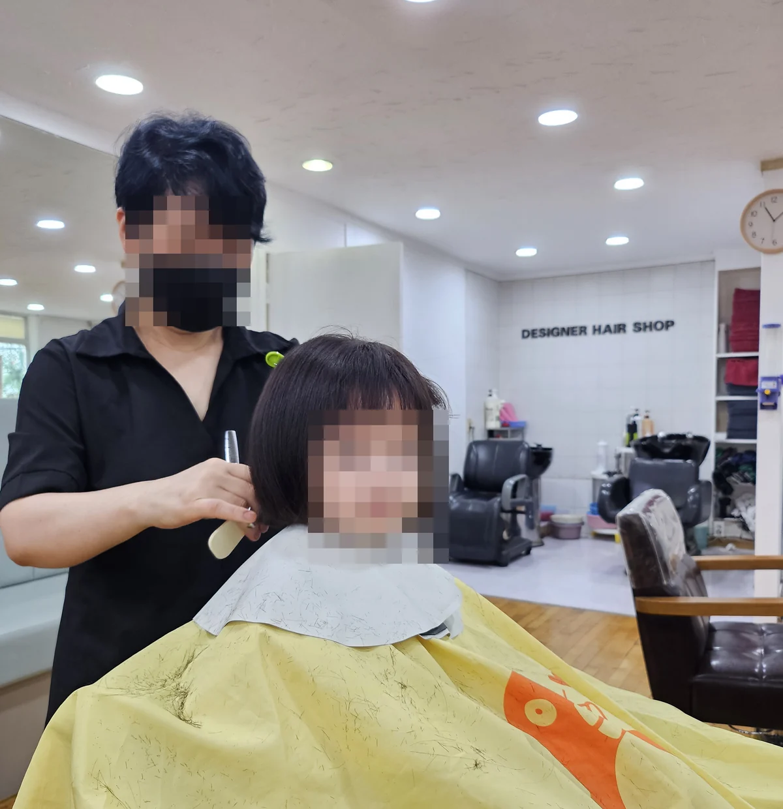

Your hair doesn't care that you moved to Korea — it keeps growing, and at
some point you have to walk into a salon and explain your head in a language
you don't speak. The good news: Korean haircuts are cheap by Western
standards, the skill level is high, and there's an option at every price.

Someone asked [on r/seoul](https://www.reddit.com/r/seoul/comments/1l6az8h/english_speaking_hair_salon/)
for a foreigner-friendly salon before leaving Seoul, and got a long list of
names back. But the most useful reply in the thread wasn't a
recommendation at all:

> *"It isn't enough that someone speaks English."*

That commenter had been picking salons at random the way they had in
Japan, and found the cutting techniques and default preferences here are
simply different — so you can explain yourself perfectly and still not get
what you wanted. Their advice was to look for **stylists with experience on
foreign hair**, and to check their Instagram to see it rather than take
anyone's word for it.

That is the real skill in this. Here are the numbers, and the two
conversations — the photo and the price — that decide how it goes.

## What it costs in Seoul

Most Korean salons do not put a price list in the window. **They publish one
online instead** — on their own Naver listing, where anybody can read it
before walking in. So rather than ranges, here are six real shops within
walking distance of each other in **여의도 and 영등포**, as their pages listed
them on **15 October 2026**.

| Shop | What it is | Cut | Perm | Colour |
|---|---|---|---|---|
| **블루클럽 당산점** | Men's budget chain | **₩12,000** | ₩47,000 | ₩35,000 grey cover · ₩47,000 fashion |
| **엉클부스 영등포본점** | Barbershop | ₩22,000 cut only · ₩32,000 with semi-shave and styling | 다운펌 alone ₩30,000 · with cut ₩63,000 | 새치염색 alone ₩40,000 |
| **리멘즈헤어 여의도본점** | Barbershop | ₩30,000 | cut + 다운펌 ₩55,000 · cut + 일반펌 ₩100,000 · cut + 아이롱펌 ₩140,000 | ₩65,000 |
| **아이디헤어 여의도 브라이튼점** | Salon | ₩35,000 | 베이직펌 ₩160,000 (men's ₩140,000) · 볼륨매직 ₩250,000 · 매직셋팅 ₩300,000 | roots ₩100,000 · full ₩150,000–190,000 |
| **가든준오 IFC몰점** | Brand salon | 디자인컷 ₩40,000 | 여성 베이직펌 S ₩198,000 · 남성 숏펌 ₩158,000 | ₩150,000 |
| **차홍룸 여의도점** | Brand salon | **₩55,000** | 숏 ₩220,000 · 단발 ₩290,000 · 미디움 ₩320,000 · 롱 **₩350,000** | 숏 ₩150,000 → 롱 ₩230,000 |

Read the cut column first. **₩12,000 to ₩55,000 for a haircut, in one
neighbourhood, on the same afternoon.** The perm column is worse: ₩47,000 to
₩350,000, a factor of seven. There is no "Korean price" for a haircut. There
is a price for the kind of shop you walk into, and the gap between the kinds
is enormous.

Two things to hold these numbers against. **여의도 is a finance district** and
sits at the expensive end of Seoul, which sits at the expensive end of Korea
— the same brands charge less in other districts and noticeably less outside
the capital. And an ordinary neighbourhood 미용실 undercuts all of this,
typically **₩15,000–25,000 for a men's cut and ₩20,000–40,000 for a
women's**. What you give up is not the basics — it is the production around
them: the sit-down consultation, a menu of stylists to choose between, the
treatment list, the interior, the drink. That is a fair trade for a trim and
a bad one for a change you care about.

*One room, one stylist, and a cape with the afternoon on it · ⓒ @BalliBalliSeoul*

**That is the other end of the table, and it is where most of Korea actually
sits.** No consultation room, no tier menu on the wall, no coffee — a cape, a
comb, and somebody who has done this ten thousand times. In a shop that size
there is usually no ladder to climb either: the person cutting is the person
whose name is on the lease.

**The wash is not one of the things you give up.** Look at the back of that
photograph: two shampoo basins in a small neighbourhood shop. A hair wash
comes with a cut almost everywhere in Korea, at every price, and it is not an
extra you have to ask for. The exception is the budget quick-cut chains, where
it may cost a little more or be skipped — which is part of what makes them
quick.

For a trim, a fringe, a child's cut or a grey touch-up, that is the entire
service, and the brand salons are selling you production you did not ask for.
For a colour correction, or a perm on hair that has been bleached before, it
is not — and knowing which of the two you have is most of what this page is
for.

> **Last verified: 15 October 2026** — prices as published on each shop's own
> Naver listing. Salon menus change, and event rates change monthly. Treat
> this as the shape of the market, not a quote.

### Three things that move the number after you sit down

**1. Your hair length.** Look at the 차홍룸 row again: the *same* heat perm is
₩290,000 on a bob and ₩350,000 past the shoulders, and their colour runs
₩150,000 at short to ₩230,000 at long. **That is a gap of ₩60,000–80,000
between tiers**, not the small surcharge people expect. Menus mark it 기장별
차등 요금. [Which perm is which, and how the length tiers
work](/blog/korean-perm-menu-explained/) covers the menu itself.

**2. Who does it.** At brand salons the price depends on **the rank of the
stylist**, and they say so on the menu in those words — 직급별 차등 요금 at
차홍룸, and 준오's list has a line that reads simply *"디자이너 직급별 가격이
다릅니다"*. The ladder runs 인턴 → 디자이너 → 수석디자이너 → 실장 → 부원장 →
원장, and the advertised price is the bottom of it. **Rank is an in-house job
title, not a higher qualification** — Korea licenses 미용사 once, nationally.
The cheapest designer at a good salon is what most Koreans book.

**3. 상담 — "ask us".** Several lines on 준오's published menu have no number
at all, just the word 상담 (*sangdam*, consultation). That is not evasion and
it is not a foreigner price; it means the job genuinely varies and they quote
it in the chair. **Expect it on 셋팅펌, on anything described as 디자인별, and
on long hair.** It is also the point at which you should name your ceiling out
loud.

And the pricing quirk that works in your favour: **no tipping, ever.** The
number on the menu is the number at the till.

One more worth knowing before a first visit. **신규 (first-visit) rates are
real and they are published.** 엉클부스 lists a cut at ₩32,000 and the same
cut as a 신규 이벤트 at ₩25,000; cut-plus-down-perm is ₩63,000 normally and
₩55,000 new. If you are shopping for a regular shop anyway, the first
appointment at each is the cheap one.

### Two cheap lines on every menu

**앞머리컷 (fringe trim) is its own item**, and it is the cheapest thing in the
building — ₩10,000 at 아이디헤어 and 준오, ₩25,000 even at 차홍룸. You can book
a salon for nothing but your fringe, and plenty of people do, every few weeks.

**주니어 컷 is cheaper, and it does not mean the same thing everywhere.** On
아이디헤어's menu it is spelled out as *~초등학생까지* — a children's cut, up to
primary school age, ₩30,000. On 준오's it sits at ₩35,000 just below the
₩40,000 디자인컷, which reads as a junior stylist rather than a junior head.
**Same two words, two different discounts.** If the price looks too good, ask
which one it is before you book it.

A caution on comparing the perm column across shop types: **barbershop prices
usually bundle the cut in, salon prices usually do not.** 리멘즈' ₩100,000
일반펌 includes the haircut; 준오's ₩198,000 does not. Two of the six shops
above are barbershops rather than salons, and that is a different business
with a differently shaped menu — [what a Korean barbershop actually is, and
what a shave involves](/blog/korean-barber-shop-guide/) covers it properly.

Two more line items to expect at a salon, both during the consultation:
treatment and clinic upsells (아이디헤어 lists scalp care at ₩120,000, 준오
a head spa at ₩158,000 — these are real services at real prices, not scams,
but they are optional), and Korea's signature **magic straight perm (매직)**,
which sits at the top of every menu. 아이디헤어 prices 볼륨매직 at ₩250,000
and a 매직셋팅 mix at ₩300,000. Quoted magic prices assume shorter hair, so
confirm the with-length total before committing.
## The salon landscape

**Budget chains** — the famous one is **Blue Club (블루클럽)**, a men's
quick-cut franchise where a basic cut was ₩12,000 at the Dangsan branch in
October 2026 — competent and no-frills; a shampoo may cost a little extra or be skipped entirely. Walk in, take
a number, done in twenty minutes. Similar low-cost cut shops live in every
neighborhood and subway station mall.

**Neighborhood salons (미용실)** — the default for most people. Run by one
or two stylists, everything from cuts to perms, and where regulars build a
relationship with "their" stylist. Quality varies, but so does everywhere.

**Brand franchises** — the names you'll see everywhere: **Juno Hair
(준오헤어)**, **Park Seung Chul Hair Studio (박승철헤어스투디오)**,
**Lee Chul Hair Kerker (이철헤어커커)**, **Chahong (차홍)**. Consistent
training, consultation culture, longer appointments, higher prices. If
you're anxious about a first Korean haircut, a brand salon's process is the
most predictable.

**English-friendly salons** — Itaewon, Hannam and Gangnam have salons with
English-speaking stylists who work with foreign hair textures daily. They
book out fast and charge brand-salon prices, but for a big change (color,
curly hair, a style you deeply care about) the communication is worth it.

## The pitch, and how to end it

This is the part nobody warns you about, and it is not a scam — it is how
the business is built.

**At brand and chain salons the upsell runs every visit.** During the
consultation you will be told what your hair needs: a treatment, a clinic
course, a better product for at home. Then, if you come back, comes the
**membership** — join up, prepay a block, get a per-visit discount. The
prepayment asked for is not small. **Hundreds of thousands of won is
routine, and it can run into the millions.**

Everything in that conversation is optional and **saying no genuinely
ends it.** Nobody chases you out of the chair. The problem is not pressure
so much as repetition: it happens at the consultation, it happens at the
basin, and it happens again at the till, and after a few visits declining
three times an appointment gets wearing.

**So set the number before you sit down.** Say what you are having and
what you are willing to spend today, and treat that figure as the whole
budget. *"오늘은 커트만 할게요"* — just a cut today — is a complete
sentence, and so is naming a ceiling and not moving past it. It converts
an open-ended sales conversation into a closed one, which is the actual
goal.

### The ten-session package

Prepaid blocks are the version of this that costs real money, so it is
worth being concrete about how they actually fail.

Someone we know bought a **ten-session hair spa package** at a good price.
They went three times. That was several years ago, and the remaining seven
are gone — not because anything dramatic happened, but because a schedule
changed, then a routine changed, and a card in a drawer stopped being
something they thought about.

**That is a Korean resident, in their own city, with no deadline.** Now
run the same arithmetic on a one-year visa. Ten sessions assumes a version
of your life that has to still be true in eighteen months' time, at that
address, with that stylist, in this country. **The discount is real. The
assumption is the expensive part.**

Two things to know before you hand anything over:

- **Do not prepay on a first visit**, whatever the discount is, and do not
  buy more sessions than your visa comfortably covers.
- **"No refunds" is not the end of the conversation.** Korea's consumer
  dispute resolution standards (소비자분쟁해결기준) treat salon packages as
  a continuing contract, and the usual outcome is that **the unused portion
  is refundable minus a cancellation charge**. It is a mediation standard
  rather than something that enforces itself — but if you are sitting on a
  card you will never finish, asking is free, and the shop saying no in the
  moment does not settle it.

And the plain version: a shop that has your money in advance has already
been paid, whatever happens to you next.

## Not all branches are the same salon

The chains publish one brand and one price list, and readers of that
Reddit thread recommended and warned about **the same chain in the same
sentence** — one branch excellent, another cutting badly and refusing to
put it right.

That is worth taking seriously as a booking method. **In Korea, people
follow a stylist, not a salon.** The recommendations that hold up are
almost always a named person at a named branch, and when that person moves,
their regulars move with them. So when you ask anyone for a recommendation
— us included — the useful question is not *which salon* but **who, and at
which branch.**

## If it comes out wrong

Ask for it to be fixed, at the salon, that day if you can.

A correction (**수정, sujeong**) on a cut that is visibly uneven is a
normal request, not an insult, and most salons will do it without charge.
What goes wrong is the delay: the thread above has someone told to come
back tomorrow, then tomorrow again, before it was finally fixed on the
third attempt.

**So do not leave the chair happy and complain later.** Look in the
mirror properly before you stand up, say what is wrong while you are still
in the room, and be specific — *this side is shorter*, not *I don't like
it*. A colour that came out the wrong tone is a harder conversation than a
crooked line, because tone is partly taste, which is one more reason the
photograph matters more than the adjectives.

## How it actually works

- **Booking runs on Naver.** Most salons take reservations through Naver
  Map's booking button; budget chains are walk-in. Phone booking works too —
  in Korean.
- **Consultation first.** Expect questions about length, layers, and
  whether you want a shampoo/styling finish. At brand salons this is a
  proper sit-down.
- **Bring a photo.** The universal language of haircuts. A reference photo
  beats any vocabulary — screenshots of K-drama actors are a completely
  normal thing to show.
- **The down perm exists.** A Korea-specific men's service that flattens
  the puffy sides of East Asian hair. If you have thick straight hair that
  wings out, this is why Korean men's cuts look the way they do. It ran
  **₩30,000–40,000 on its own** at the shops above in October 2026, and less
  when bundled with the cut.
- **Carry cash.** Salons take cards, but foreign cards are the ones that
  get declined at the terminal, and it is a bad moment to discover that
  with wet hair. Redditors in that thread mention salons preferring cash
  for exactly this reason. The wider problem is in
  [why your foreign card gets refused](/blog/coupang-korea-shopping-guide/).

**A note on booking.** Naver's reservation button is the normal route, and
it is also a verification wall — most Naver bookings want a Korean phone
number in your own name. If that stops you, phoning the salon works, and
so does walking in, which is how budget chains run anyway.

## The Korean part

Hair is high-stakes vocabulary. "Trim the ends but keep the length,"
"thin it out but not choppy," "not too short around the ears" — this is
exactly the nuance that translation apps butcher, and a misunderstanding
grows out over months. Add Korean-only phone bookings, tier menus, and
explaining your hair history (that bleach job from two years ago matters
for a perm), and plenty of expats just... stop getting haircuts.

Most of this is solvable without anyone's help. **Bring the photograph,
name your ceiling, and pay in cash**, and a neighbourhood salon will
usually get you a good result for ₩20,000.

Where it stops being easy is the specific stuff — a colour correction, a
perm on hair that has been bleached before, curly or fine hair that a
stylist may not have worked on. That is a conversation, not a phrase, and
it is the one worth handing over. Through our
[anything-else concierge service](/etc) we find a stylist who has actually
done your hair type, book the time, and brief them in Korean beforehand —
your photo, your do-nots, your hair history, and the ceiling you set.

**No salon pays us. You do**, so the stylist we point you at is the one
we would send a friend to.

## Get it sorted

> **Overdue for a cut but dreading the conversation?** Send us a photo of
> what you want on [WhatsApp](https://wa.me/821075191282) — we'll book a
> salon that fits your budget and brief the stylist in Korean before you
> sit down. First answer is free.

And a low-risk way to start: try a neighborhood salon for a simple trim
first. Worst case, hair grows back — and in Korea, the retry only costs
₩20,000.
