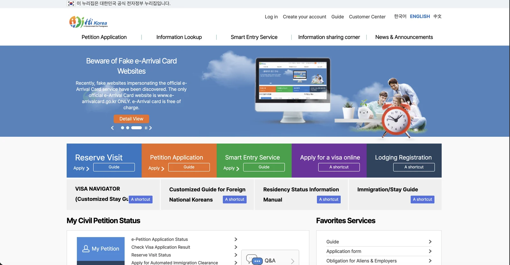

Sooner or later every foreign resident in Korea ends up on **HiKorea**. It is
the government's immigration portal, and it is where you book a visit to an
immigration office, file an e-application, and check what happened to one.

It is also where people get stuck — not because the procedures are hard, but
because the website is. This is a guide to **using the site**, in English.

> **We are not the Ministry of Justice or the Korea Immigration Service, and
> this is not immigration advice.** Nothing here tells you which permission
> you need or whether you will get it. That question goes to the **1345
> Immigration Contact Center**, to the office itself, or to a licensed
> administrative agent. This page is about the website.
>
> **Last verified: 7 October 2026.**

## First: check the address

The official site is:

**`www.hikorea.go.kr`**

The part that matters is the ending. **`.go.kr` is reserved for Korean
government bodies** — nobody else can register one. Any other ending is not
the government portal, whatever the page looks like.

This is worth a sentence because a surprising number of people search for
HiKorea with a `.com` on the end and land somewhere else entirely. Before you
type a passport number, a registration number or a phone number into anything
that looks official, **read the address bar and check it ends in `.go.kr`.**
That one habit covers you across every Korean government site, not just this
one.

*The English home page, with the notice banner running · hikorea.go.kr, October 2026 · ⓒ @BalliBalliSeoul*

**And you do not have to take our word for it, because the government says it
on its own front page.** The banner running on the home page in October 2026
warns about fake sites impersonating the e-Arrival Card service, states that
`www.e-arrivalcard.go.kr` is the only official one, and adds the detail that
matters: **the e-Arrival Card is free of charge.**

That is the shape of the scam, and it is worth recognising because it is the
same shape every time. A site that looks official, for a service that is
genuinely free, charging a fee to do it for you. **If a Korean government
service is asking you for a card number on a page that does not end in
`.go.kr`, stop.**

## Switching the site to English

The language selector sits at the **top right of the page** — 한국어, ENGLISH,
中文 — above the main menu, as in the screenshot above. Pick English and the
navigation changes.

Then the honest part, which no official page will tell you: **the English
version is not a full translation.** The top-level menus come across, but
plenty of links drop you onto a Korean-only page, and some notices and forms
exist only in Korean. This is the single most common reason people give up on
the site, and it is not something you are doing wrong.

Two things help when it happens:

- **Your browser's translate function** on the Korean page. Machine
  translation of Korean government text is imperfect but usually good enough
  to find the button you want.
- **Keep the English page open in a second tab** to know where you are in the
  structure, and use the Korean page to actually click through.

## What each part of the site is for

The English site has **two layers, and people only ever notice one.**

Across the top sits the main menu:

| Top menu | What it does |
|---|---|
| **Petition Application** | File certain applications online instead of going in person. Fees are generally lower online than at a counter, and it saves the trip |
| **Information Lookup** | Check the status of something you have already filed |
| **Smart Entry Service** | Automated immigration clearance — the gates you walk through instead of queueing for an officer. Worth a look if you fly often |
| **Information sharing corner** | Reference material: what each procedure requires, which documents, which office |
| **News & Announcements** | Notices. This is where changes get posted first, and usually in Korean first |

Below the banner sits a **row of coloured tiles** — shortcuts to the same
services, with **Reserve Visit** at the far left, plus Petition Application,
Smart Entry Service and Lodging Registration among them.

**That row is the layer people miss.** Reserve Visit — the single most useful
thing on the site — is a tile on the home page, not an entry in the top menu.
If you have been scanning the menu bar for it and not finding it, that is why.

Which of these applies to your own situation is exactly the question we do
not answer. The site's own guide section does, and 1345 does it in your
language.

## If you want a screen-by-screen walkthrough

The site's own help is thin. What fills the gap is slightly unexpected:
**Korean universities publish step-by-step guides for their own international
students, and those guides are public.** They are written by people who spend
every semester walking confused students through the same screens.

One in English, covering the e-application flow for extending a period of
stay, is published by Sungshin Women's University's international office —
[HiKorea manual, English version
(PDF)](https://www.sungshin.ac.kr/bbs/siie_kor/4973/131498/artclView.do).

Two things to hold in mind when you open it. **It was posted in June 2024**,
so some screens will have moved since; the sequence and the Korean labels
tend to outlast the layout. And **it is a university's guide, not a Ministry
document** — we did not write it, we cannot vouch for it being current, and
it does not tell you what your own case needs. For that, 1345.

If your university or employer has an international office, ask whether they
publish one of their own. Many do, and theirs will be the version written for
people in your situation.

## Booking a visit is the important one

If you take one thing from this page: **immigration offices work by advance
reservation.** Turning up without one generally means you will not be seen.
The booking is made on HiKorea under **Reserve Visit** — the blue tile on the
left of the home page, with `Apply` under it and a separate `Guide` button
beside it.

Two practical notes.

**You do not necessarily need an account.** Alongside signing up for
membership, the booking flow offers a **non-member route** where you verify
your identity and continue. If creating an account is where you got stuck,
try that path instead.

**Book early, and treat the slot as the scarce thing.** Popular offices run
out of slots well before the dates you want, and the busy ones are busy for
the same reason everything else in Korea is — everyone has the same deadline.
If something in your life has a date attached, the booking is the first thing
to arrange, not the last.

## The authentication wall

The other place people stall is identity verification. Korean sites
traditionally verify you through a certificate or a mobile check tied to a
**Korean phone number in your own name**, and foreign residents often do not
have one yet, or have one in someone else's name, or on a prepaid plan that
the check will not accept.

If that is where you are, it is the same wall that blocks banking and
delivery sign-ups — the background is in
[opening a bank account in Korea](/blog/open-bank-account-korea/) and
[renting without an ARC or a Korean phone](/blog/student-housing-seoul-no-arc/).
Solving it once tends to unlock several sites at the same time.

## When the site will not cooperate: 1345

**1345** is the Immigration Contact Center. It answers in a long list of
languages, it is free, and it is staffed by people whose job is this.

It is the right call for anything the website cannot tell you — what your
situation requires, which document is missing, what a Korean-only notice
says. It is also the right call before you pay anyone for an answer.

For context on Korea's other numbers, [112, 119 and the rest are
here](/blog/korea-emergency-numbers-112-119/), and travellers rather than
residents usually want [the 1330 travel
hotline](/blog/korea-travel-hotline-1330/).

## Two portals people mix up

HiKorea is not the only `.go.kr` site you will be sent to, and the two get
confused constantly:

| Site | What it is for |
|---|---|
| **hikorea.go.kr** | Immigration — e-applications, office bookings, progress checks |
| **socinet.go.kr** | The Social Integration Program (KIIP) — course registration and schedules |

If you are looking for Korean classes, levels or the placement test, you want
the second one, and [what KIIP costs in hours and
fees](/blog/kiip-levels-hours-fees/) explains what you will find there.

And a third thing worth knowing: **some reports are not made on HiKorea at
all.** A change of address, for example, can be reported at the community
service centre of the district you moved into — and it has a deadline, which
is one of the questions in [our KIIP society
quiz](/blog/kiip-culture-test-questions/).

## What we do not do

**We do not handle immigration matters.** We do not advise on permissions, we
do not prepare or submit applications, and we do not accompany people to
immigration offices. That work belongs to licensed administrative agents and
to the 1345 centre, and we would rather say so plainly than be vague about it.

One thing worth knowing before you pay anybody: filing on your behalf requires
an office registered with the Ministry of Justice as an immigration filing
agent (**출입국민원 대행기관**). Plenty of places advertise visa help without
holding that registration. Ask to see it.

One office we know holds it: **안앤정행정사** — pronounced *An-aen-jeong*, the
practice of An and Jeong — in Seocho-gu, Seoul. They tell us they work in
English. Their blog is [here](https://blog.naver.com/bird5127), in Korean
only, and the number listed on it is 010-4694-7410. Copy the Korean name above
if you need to search for them, or to show somebody where you are going. **We
are paid nothing for this and have no stake in whether you use them.**

And one distinction worth carrying into any of those conversations: **a
refusal is a different problem from an application.** Extensions, status
changes and first filings are administrative-agent work. A refused
application, an objection, or a departure order is a lawyer's job.

## Get it sorted

> **Everything else that is in Korean, though — that we do.** Landlords,
> building managers, telecoms, delivery disputes, repair bookings, clinics,
> and the forms that are not immigration forms. Describe the problem in
> English on [KakaoTalk](https://pf.kakao.com/_RJxhSX/chat) and we will tell
> you whether it is something we can take. Asking costs nothing, and if it is
> not ours, we will say so and point you at who it belongs to.

Procedures, menus and screens on government sites change without much notice.
Everything above describes the site as of **October 2026** — if a page has
moved, trust the site over this one, and trust 1345 over both.
