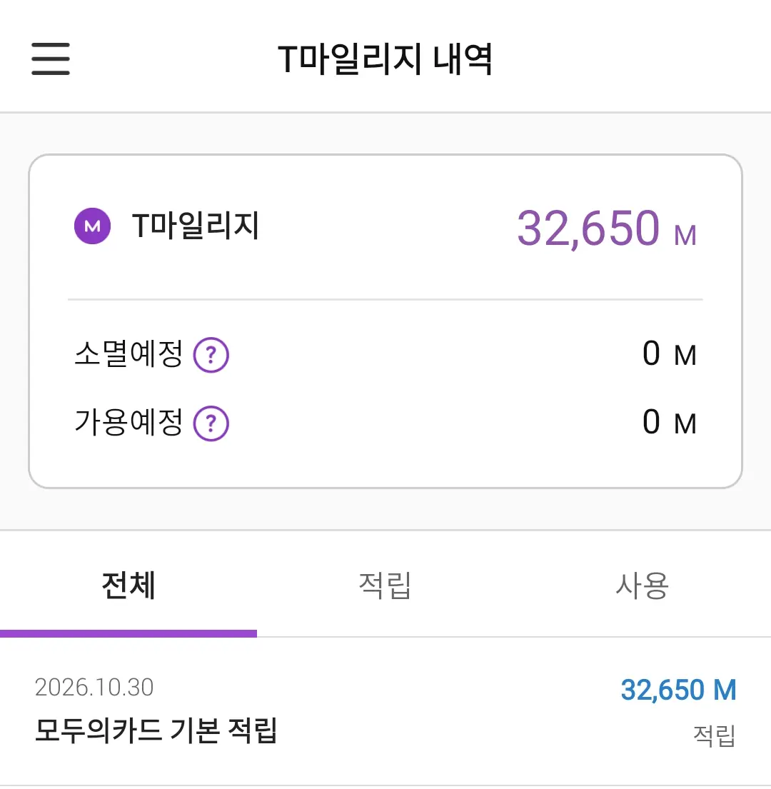

**K-Pass** gives you **20% of your public transport spending in Korea back**,
and most foreign residents who qualify never collect it. Not because the scheme is
hard, but because it has been renamed twice, the English guides are out of
date, and the money arrives weeks after you stopped expecting it.

Here is the screen that prompted this post. One line, one payment, dated
**30 October 2026**.

*32,650 mileage points, which top the card up one-for-one with won. That date
is not a coincidence, and it is the part no English guide gets right.*

## Why is K-Pass now called Modu Card?

This is why your search results contradict each other:

| When | Called |
|---|---|
| until April 2024 | 알뜰교통카드 (Almoon transport card) |
| May 2024 – August 2026 | **K-Pass** (K-패스) |
| **since 12 August 2026** | **모두의카드 / Modu Card** ("everyone's card") |

K-Pass and Modu Card are **one scheme the whole way through** — same operator, same refunds, no
reapplying. English-language pages still say K-Pass, Korean pages and apps now say
모두의카드, and both describe the same card in your wallet. This post uses
**K-Pass** throughout, because that is still what English speakers search for.

> The official site is [korea-pass.kr](https://korea-pass.kr/), and it is
> Korean-only. There is no language switcher and the official app ships in
> Korean alone. Budget for a translation app or a Korean-reading friend.

## The question that decides everything: do you have an ARC?

Before any of the numbers matter, there is a gate.

The sign-up page says **"외국인도 OK!"** — foreigners welcome — and that is
true as far as it goes. But registration runs through Korean identity
verification: a bank certificate, a phone check tied to **a Korean number in
your own name**, a 공동인증서, or a Kakao/Naver account that was itself opened
with one. All four assume a Korean resident registration or an **alien
registration number**.

| Your situation | Realistically |
|---|---|
| Hold an ARC | Get the card, register, collect every month |
| Applied, waiting for the card | Wait. Use an ordinary transit card meanwhile |
| Staying 90 days or less | **No ARC exists for you.** See the last section |

Under the Immigration Act, foreign nationals staying **more than 90 days**
register within 90 days of arrival. Short visitors have no number to enter,
so the form stops them. If you are still at the stage of getting that
identity layer working at all, the same wall blocks banking —
[opening a bank account in Korea](/blog/open-bank-account-korea/) covers it.

**And one trap that costs people their first month:** getting the card is not
joining. Trips taken before you register the card number do not count. Card
in hand, then register, then start riding.

## How much does K-Pass actually refund?

The K-Pass refund is a percentage of what you spent. You do not pick a tier;
the system applies whichever is better for you.

| You are | Base rate | In the staggered hours |
|---|---|---|
| **General**, 35–64 | **20%** | **50%** |
| Youth, 19–34 | 30% | 60% |
| Senior, 65+ | 30% | 60% |
| Two children | 30% | 60% |
| Three or more children | 50% | 80% |
| Low income | 53.3% | 83.3% |

Those boosted rates apply when you tap in during **05:30–06:30, 09:00–10:00,
16:00–17:00 or 19:00–20:00** — a congestion measure that pays you to travel
off-peak. Shifting your commute by an hour moves a general rider from 20% to
**50%**.

This boost was due to end on 30 September 2026. On 28 September the ministry
**extended it to 31 December 2026**, and it is expected to be written into
the 2027 budget.

### What did end on 30 September

There is a second refund style — a spending threshold, where everything above
a monthly figure comes back in full. Between April and September 2026 that
threshold was cut by half. **That cut expired with September's travel.**

| Seoul area threshold | Apr–Sep 2026 | **From October** |
|---|---|---|
| Standard | ₩30,000 | **₩62,000** |
| Plus (incl. express buses, GTX) | ₩50,000 | **₩100,000** |

If you read a guide written over the summer — and most of the English ones
were — it will quote the cheap thresholds. They are gone. The off-peak
percentages are the part that survived.

## Fifteen trips a month — and what K-Pass counts as one

K-Pass needs **15 or more trips in a calendar month**. Miss it and that month
pays nothing. Your first month after joining is exempt.

A "trip" is not a tap. It is a **journey**: from your first boarding until the
transfer window closes, up to four transfers in the Seoul area. Bus to subway
to village bus on one commute is **one**, so a normal working day earns you
two. The old caps — two per day, sixty per month — were **both scrapped in
2026**, so there is no ceiling any more.

If the transfer rules themselves are the confusing part, they are set out in
[Seoul subway fares](/blog/seoul-subway-fare-guide/).

## What earns a K-Pass refund, and what does not

**Earns:** city, town and express buses · subway and metropolitan rail,
including GTX and the Shinbundang line · the **airport railroad's ordinary
trains**.

**Does not earn:** intercity and express coaches · **airport buses** · the
airport railroad's *express* train · KTX and SRT.

The rule underneath is simple: **if you buy a ticket rather than tap a card,
it does not count.** Which produces the trap worth memorising — going to
Incheon, the *train* earns and the *bus* does not.

Where you ride does not matter. Registered in Seoul and riding in Busan still
earns. Since February 2026 every district in the country takes part.

## When does the K-Pass refund actually arrive?

This is the part that sends people to the help desk, and it is where the
English guides are simply wrong.

**The refund moves in two stages**, and most articles only describe the first:

1. The scheme totals your month and sends the money **to your card company on
   the 7th working day of the following month.**
2. **Your card company then pays you on its own schedule** — and those differ
   by up to **22 days**.

Stage one is the number everyone quotes. Stage two is the one you actually
experience.

| Your card | You are paid |
|---|---|
| Shinhan, Samsung, Woori, NH, Hana, Lotte, BNK Busan | 7–10 working days |
| Jeonbuk, K-Bank, Shinhyup | the 15th |
| Kakao Bank, EZL, Naver Pay, Kakao Pay | the 20th |
| Rail Plus | the 20th–25th |
| Toss Bank | the 25th |
| **KB Kookmin, T-money** | **the last working day of the month** |
| BC, Hyundai, IBK, Gwangju, BNK Gyeongnam | on your statement date |

T-money's own wording is unambiguous: credited as T-mileage **"on the last
working day of the month following the month of use, excluding weekends and
holidays."**

So the screenshot at the top is the system working correctly. September's
travel, paid on **Friday 30 October 2026** — the last working day, because the
31st was a Saturday. Had we been on a Shinhan card, the same money would have
arrived around **9 October**, three weeks earlier.

**Mobile T-money is the route many foreign residents take**, because it needs
no Korean credit card. It is also the slowest-paying option on the list. That
is a fair trade, but it is worth knowing before you conclude your refund has
been lost. Our [T-money card guide](/blog/t-money-card-korea-guide/) covers
the card itself.

Two more timing notes. Trips take **up to two weeks** to appear in your
history, so a missing journey today is usually not missing. And refunds are
paid from a budget — in December 2024 some districts paid out **reduced**
amounts when the money ran low. It is rare, but it is not guaranteed.

## No ARC? What to use instead

No ARC means no K-Pass registration, and no refund. Seoul's own guidance points
short-term visitors to the **Climate Card short-term pass** (1, 2, 3, 5 and 7
days, ₩5,000–20,000) instead.

It is the opposite design: a flat pass, no sign-up, no identity check, no
15-trip rule, nothing to collect later. The trade-offs are that it covers
**Seoul only** — no GTX, no Shinbundang, no express or airport buses, no
subways in other cities — and it **cannot be loaded in advance**, so you charge
it the day you start.

The 30-day Climate Card was wound down this autumn and folded into this
scheme; the short-term passes continue. What replaced what, and on which
dates, is in
[Seoul's Climate Card is ending](/blog/seoul-climate-card-ending-k-pass/).

For everything a transit card does not cover — KTX, intercity coaches, taxis
between cities — see [getting around Seoul](/blog/seoul-transportation-guide/).

## Get it sorted

If you hold an ARC and ride more than fifteen times a month, this is free
money you are currently leaving behind: roughly **₩30,000 back on ₩150,000 of
travel**, and more if you can move a daily trip into an off-peak hour.

The two things that stop people are both fixable. **Register the card, not
just order it** — trips before registration do not count. And **check the
right date for your card** before deciding the refund never came.

> **The Korean part is what we do.** If the sign-up screen stops you, or the
> card company's Korean-only help desk does, describe it in English on
> [KakaoTalk](https://pf.kakao.com/_RJxhSX/chat) and we will tell you whether
> it is something we can take on. Asking costs nothing, and if it is not
> ours, we will say so and point you at who it belongs to.

Rates, thresholds and payment dates are as published in **October 2026**, and
this scheme has been revised every year it has existed. The off-peak boost is
confirmed only to **31 December 2026**. Check
[korea-pass.kr](https://korea-pass.kr/) before you plan around any figure here.
