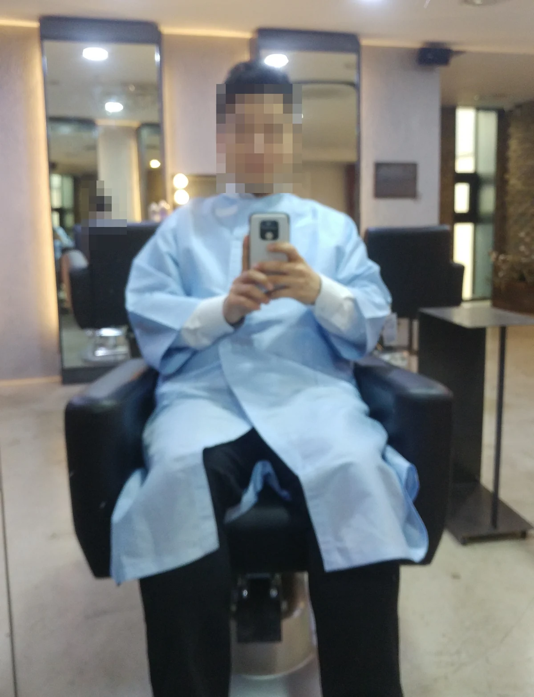

Search for a barber in Korea and you will be shown three different kinds of
business that English flattens into one word. Walking into the wrong one is
how people end up with a cut they did not want, or a conversation they were
not expecting.

Here is what the three are, what a cut costs, and how to find one where
somebody speaks English.

## 바버샵, 미용실, 이발소 — the three are not the same

| Korean | What it is |
|---|---|
| **바버샵** (*babeosyap*) | The modern men's barbershop. Fades, scissor cuts, pomade, hot towel, often a straight-razor finish. Usually appointment-based |
| **미용실** (*miyongsil*) | A hair salon. Unisex, cuts and colour and perms, the default for most Koreans of any gender |
| **이발소 / 이용원** (*ibalso / iyongwon*) | The traditional barber. Older clientele, cheap, and the only one of the three built around shaving |

The split is not just style. **Barbering and hairdressing are separately
licensed trades in Korea** — 이용업 and 미용업 — with different qualifications
behind the counter. A 미용실 will cut your hair beautifully and will usually
not take a razor to your face.

So the question *"where is a good barber"* has a different answer depending on
whether you want a **fade and a shave** (바버샵), **a cheap tidy-up**
(이발소 or a budget chain), or **a cut with colour** (미용실).

For salons specifically — prices, the upsell, the ten-session package, and the
down perm that gives Korean men's cuts their shape — that is a whole article
of its own: [hair salons in Korea](/blog/haircut-in-korea-prices-salons/).

## One warning about old-style 이발소

A small number of very traditional barbershops — usually basement or back
street, blacked-out windows, no visible price list, a spinning pole and little
else — are not only barbershops. It is a well-known category locally and
nobody will think badly of you for not knowing.

**How to avoid the confusion entirely:** go to places with a visible price
list, clear windows, and reviews with photographs of haircuts. Modern 바버샵
and 이용원 near stations and in commercial buildings are unambiguous. If a
place has an Instagram account full of fades, it is a barbershop.

## What it costs

Barbershops rarely post a list on the glass, but they publish one online.
Here are three real shops in **영등포 and 여의도**, as their own Naver pages
listed them on **15 October 2026**:

| | 블루클럽 당산점 | 엉클부스 영등포본점 | 리멘즈헤어 여의도본점 |
|---|---|---|---|
| What it is | Budget men's chain | Modern 바버샵 | Modern 바버샵 |
| **Cut** | ₩12,000 | ₩22,000 cut only | ₩30,000 |
| **Cut + shave + styling** | — | ₩32,000 | — |
| **Down perm** | — | ₩30,000 alone · ₩63,000 with cut | ₩55,000 with cut |
| **Perm** | ₩47,000 | — | ₩100,000 with cut · 아이롱 ₩140,000 · 볼륨매직 ₩120,000 |
| **Colour** | ₩35,000 grey · ₩47,000 fashion | ₩40,000 grey, alone | ₩65,000 |
| **Hair / scalp care** | upgraded cuts: 비타민커트 ₩16,000 · 클리닉커트 ₩25,000 | — | 모발케어 ₩50,000 · 두피케어 ₩40,000 |

> **Last verified: 15 October 2026.** These are 영등포 and 여의도 — ordinary
> commercial Seoul. Barbershops in Gangnam, Hannam and Itaewon run higher, and
> shops outside Seoul run lower.

**The headline: a real barbershop cut in Seoul is roughly ₩22,000–30,000**,
about double a budget chain and well under what the same haircut costs in most
Western capitals.

### Barbershop menus are built out of combinations

Look at the shape of those lists rather than the numbers. Almost every line is
**컷 + something**: cut and down perm, cut and colour, cut and shave. The
à la carte version exists but is labelled **Only** — *Only 커트*, *Only
다운펌* — and it is usually the worse deal. 엉클부스 charges ₩30,000 for a down
perm alone and ₩63,000 with the cut, so the haircut inside that bundle costs
₩33,000 against ₩22,000 on its own.

**Decide what you want before you look at the menu**, because the menu is
built to sell you the pair.

### The shave is not the add-on you expect

Nothing on these menus prices a face shave separately. 엉클부스 sells **커트 +
세미쉐이빙 + 포마드 스타일링 for ₩32,000** against ₩22,000 for the cut alone —
so the shave and the finish together are about ₩10,000.

Note the word 세미 (*semi*). **A 세미쉐이빙 is the outline** — neck, edges,
around the ears — not the full hot-towel face shave described below. If the
full thing is what you came for, ask for 면도 specifically and ask the price,
because at most modern barbershops it is not on the published list at all.

### First visits are cheaper, and they advertise it

엉클부스 lists a **신규 이벤트** — a first-visit rate — beside several of its
normal prices: ₩25,000 for the cut-shave-styling against ₩32,000, and ₩55,000
for cut-plus-down-perm against ₩63,000. 리멘즈 posts ₩25,000 for serving
military, police and firefighters.

Neither is a coupon you have to hunt for; both sit on the public price list.
If you are trying shops to find a regular one anyway, **the first appointment
at each is the cheap one** — which is a reason to try three before settling.

A barbershop cut in Seoul is a service rather than an errand: an hour, a
consultation, a wash, sometimes a coffee. If you want fifteen minutes and a
number two, the budget chains do that better and for a third of the price.

*Gowned, seated, and about ten minutes into an hour · ⓒ @BalliBalliSeoul*

**The gown is the tell.** Western barbers throw a cape over your shoulders and
tuck a strip of paper in your collar. Korean shops put you in a full-length
gown with sleeves, over your clothes, down past your knees — and they do it
before anything else happens.

That is not fussiness. It is the building telling you how long you are going to
be sitting there. **Nobody gowns you to the ankles for a ten-minute trim.** If
you are in and out of the chair in fifteen minutes, you were in the wrong kind
of shop for what you wanted — or, more often, the right kind for a price you
did not need to pay.

### The price also depends on who cuts you

Barbershops run the same internal ladder salons do — **바버 → 수석 → 원장** —
and the rate climbs with it. The number on the website is the bottom rung.

That matters more than usual here, because barbershops rarely post a price
list on the glass; **the menu lives on their Instagram or their booking page**,
tier by tier. Read it before you walk in, and when you book, look at whose
name is attached to the slot — the first free appointment is not always the
cheapest one.

The ranks are shop titles rather than qualifications. Korea licenses 이용사 and
미용사 as single national certificates; 원장 means the senior person at that
address, not a higher grade of barber.

## The shave is a different thing here

If you have only had a razor at a Western barbershop, the Korean version is
worth trying once. A hot towel, a lather, a straight razor, and — the part
nobody warns you about — **the face shave usually includes the forehead,
cheekbones and the fine hair along the jaw**, not just the beard line. It is
normal, it is not a mistake, and skin feels startling afterwards.

If you do not want that, say so at the start. **"면도는 수염만 해주세요"**
(*myeondo-neun suyeom-man hae-juseyo*) — "please shave only the beard."

## How to find one that speaks English

The honest answer is that very few barbershops advertise English, and the ones
that do are clustered in the obvious places. But the search is more winnable
than it looks, because **Korean barbershops live on Instagram.**

**1. Search Instagram, not the web.** Try the neighbourhood plus 바버샵 —
`이태원바버샵`, `연남동바버샵`, `강남바버샵`. You get photographs of actual
work, which tells you more about whether a shop can cut your hair than any
review will. **DM them in English.** Barbershop accounts are run by the
barbers, and a DM gets answered in English far more often than a phone call
does.

**2. Use the map apps for what they are good at.** Search 바버샵 in
[Naver Map](/blog/naver-map-korea/) or [Kakao Map](/blog/kakao-map-korea/) to
see what is near you, with opening hours and whether booking is needed. Reviews
will be in Korean; your browser will translate them well enough to spot a
pattern.

**3. Go where the foreign customers already are.** Itaewon, Haebangchon,
Hannam and parts of Yongsan have barbers who cut non-Korean hair every day,
and that matters more than language does.

**4. If your hair is curly, coily or very thick, make that the first
question.** A great many Korean barbers have simply never cut it, and a
skilled barber who says "I have not worked with this texture" is being honest
rather than unhelpful. Itaewon is where to start, and Instagram is how to
check — look for photographs of hair like yours before you book.

**5. Bring a photograph.** Two, ideally: the front and the back. This is the
single highest-leverage thing you can do in any Korean hair appointment, and
it works even with no shared language at all.

## The words that actually get used

You do not need many. These are the ones that change the outcome:

| English | Korean |
|---|---|
| Just a trim, not short | 조금만 다듬어 주세요 |
| Short on the sides | 옆머리 짧게 해주세요 |
| Leave the top long | 윗머리는 길게 남겨 주세요 |
| Fade | 페이드 (the English word is used) |
| Don't thin it out | 숱은 치지 말아 주세요 |
| Shave the beard only | 면도는 수염만 해주세요 |
| No perm, thank you | 펌은 괜찮아요 |

The last one matters more than it looks. A down perm is a genuine
recommendation rather than a hard sell — it is what makes Korean men's cuts
sit flat — but it adds time and money, and you should choose it rather than
discover it on the bill.

## Get it sorted

> **Found a shop on Instagram and stuck at the booking?** Send us the account
> or the map pin on [KakaoTalk](https://pf.kakao.com/_RJxhSX/chat) and we will
> make the appointment in Korean, say what you want done, and tell you what
> they said back. We do not take commission from any shop, and we do not
> recommend one we have not seen work — what we are good for is the Korean,
> not the hair.

One last thing, which applies in every chair in the country: **the
consultation is the haircut.** Five minutes with a photograph and the words
above decides the result far more than the shop you chose. Korean barbers are
technically excellent and will do exactly what they understood you to want —
so the job is making sure that is the same thing.
