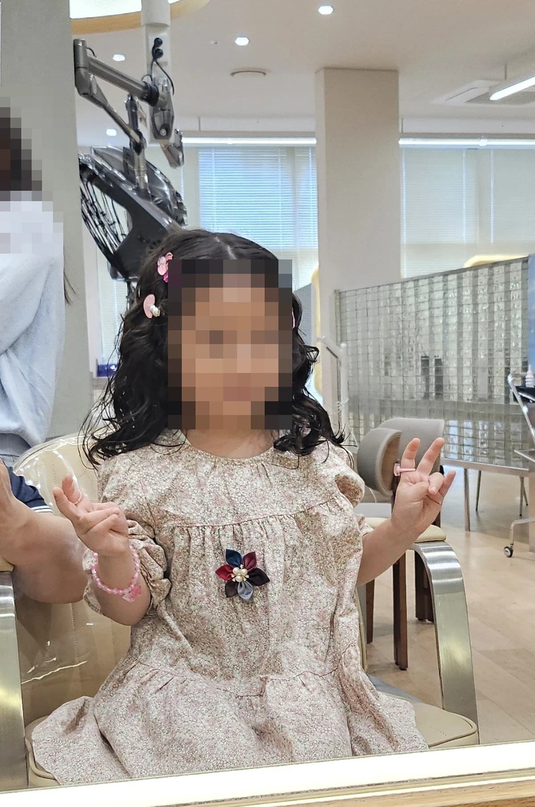

A Korean salon menu has a dozen things on it that have no equivalent where
you came from. **디지털펌, 매직, 볼륨매직, 다운펌, 가르마펌, 히피펌** — they
are not variations on one idea, they are genuinely different services with
different machines, different durations and very different prices.

This is what each one is, who it is for, and the pricing rule that explains
the number you will be quoted.

For what a cut costs, how the upsell works, and how to shut it down, that is
the companion piece: [hair salons in Korea: prices, photos and the
upsell](/blog/haircut-in-korea-prices-salons/).

## First, the rule that explains every price

**Korean salons price by hair length, in tiers.** Roughly: 단발 (bob, to the
jaw), 중단발 (to the shoulder), 장발 (below the shoulder), and sometimes a
tier beyond that.

The same perm on long hair can cost twice what it costs on a bob, because it
is genuinely twice the work and twice the product. So **a price on a menu
board or an Instagram post is the starting tier**, not your price.

You do not have to take that on trust. Here is one Seoul salon's published
menu — **차홍룸 여의도점**, as listed on 15 October 2026. Same salon, same
treatment, four lines:

| Heat perm (열펌) | Price |
|---|---|
| 숏펌 — short | ₩220,000 |
| 단발펌 — bob | ₩290,000 |
| 미디움펌 — to the shoulder | ₩320,000 |
| 롱펌 — past the shoulder | **₩350,000** |

Their colour menu does the same thing: ₩150,000 at short, ₩170,000 at a bob,
₩200,000 at medium, ₩230,000 long. **The gap between tiers is ₩30,000–60,000,
and end to end it is ₩130,000** — which is not a surcharge, it is a different
price. Menus label it 기장별 차등 요금.

**Ask this before you sit down:** 제 머리 길이면 얼마예요? — *"How much for my
hair length?"*

## And the second axis: who does it

Length is one multiplier. **The other is the rank of the person holding the
scissors**, and it moves the price at least as much.

Korean salons run an internal ladder, and they say so on the price list in
those words. 차홍룸's menu marks the cut, the perm and even the blow-dry
**직급별 차등 요금** — *rates differ by rank*. 가든준오 IFC몰점 goes further and
prints a line with no price at all, reading only *"(디자이너 직급별 가격이
다릅니다)"*.

The ladder behind that wording:

| Title | Roughly | What it means |
|---|---|---|
| **인턴** (*inteon*) | Intern | Shampoos, assists, applies product. Does not cut |
| **디자이너** (*dijaineo*) | Designer | **The baseline.** The price you see advertised is almost always this one |
| **수석디자이너** (*suseok*) | Senior designer | Longer in the chair, more in demand |
| **실장** (*siljang*) | Manager | Senior staff, often running a team |
| **부원장 / 원장** (*buwonjang / wonjang*) | Deputy / director | The owner or the name on the door. The top column |

Two things follow from that, and they are the practical ones.

**The headline price is the bottom of the ladder.** A salon advertising a
₩50,000 perm means ₩50,000 *with a 디자이너, at the shortest length tier*. Your
actual number is that figure plus a length tier plus a rank tier, which is how
a ₩50,000 perm becomes ₩90,000 at the till without anybody misleading you.

**Rank is an in-house title, not a separate qualification.** Korea has one
national hairdressing licence (미용사 면허); 원장 and 실장 are job titles inside
that shop, the way "senior" is anywhere else. Paying up buys experience and
demand, not permission. **A 디자이너 at a well-reviewed salon is not a downgrade**
— it is the tier most Koreans book.

### When the menu says 상담 instead of a number

On 준오's published list, several lines carry no figure at all — 셋팅펌, and
anything marked 기장별 차등 or 디자인별 — just the word **상담** (*sangdam*),
meaning consultation.

That is worth recognising rather than fearing. It is not a foreigner price and
it is not evasion: it means the job varies enough that they quote it in the
chair, after looking at your hair. **What it does mean is that you will be
agreeing to a number verbally, with a gown on, after the consultation has
already warmed you up** — which is the moment to say your ceiling out loud
rather than nod.

Where it catches people out is booking apps. Naver lists the shop's stylists
individually and the price updates when you pick one, so tapping the first
available slot can quietly select the 원장. **Check whose name is on the
reservation before you confirm it.**

## The two families

Almost everything divides into **heat perms** and **cold perms**, and the
difference decides what your hair looks like day to day.

| | How it works | The curl shows |
|---|---|---|
| **열펌 — heat perm** (digital, setting) | Chemical plus heated rods | **When dry.** Looks loose when wet, comes alive after blow-drying |
| **일반펌 / 콜드펌 — cold perm** | Chemical only, no heat | **When wet.** Bouncier, tighter, more "natural curly" |

This is the single most useful thing on this page. People ask for a perm,
describe a photo of dry styled hair, get a cold perm, and are confused for
three months. **If the photo you are holding shows dry, styled, loose waves,
you want a heat perm.**

*A 열펌 needs the arm above the chair. A 콜드펌 needs none of it · ⓒ @BalliBalliSeoul*

**You can often tell which one you are booked in for by looking at the
ceiling.** Heat perms run off equipment — an articulated arm that swings over
the chair, rods that plug into it, a timer somebody sets. Cold perms are
chemistry and waiting, and need none of that hardware.

So if the price surprised you and nobody has wheeled anything over, it is
worth asking the question before the solution goes on rather than after.

## Women's

**디지털펌 (digital perm)** — the famous one. Heated rods on a machine that
holds a set temperature, producing soft curls that appear once hair is dried.
Low maintenance by design: you are meant to wash, rough-dry and go. Long, and
hard on the hair. Budget **two to four hours**.

**세팅펌 (setting perm)** — the same heat-perm family, different rods and
technique, often tighter or more structured. Salons use the two words loosely;
show a photo rather than argue about the name.

**히피펌 (hippie perm)** — loose, undone, beachy waves. Currently everywhere.
Usually a cold or low-heat perm depending on the length.

**볼륨 / 뿌리펌 (volume or root perm)** — perms only the roots to lift flat
hair at the crown. Quick, relatively cheap, and the answer for fine hair that
goes flat by lunchtime.

**매직 / 매직스트레이트 (magic straight)** — the opposite service. Chemical
straightening worked through with a flat iron, section by section. Extremely
effective on frizz and wave, extremely long — **three to five hours is
normal** — and the most expensive thing on most menus.

**볼륨매직 (volume magic)** — straight through the lengths, but with lift kept
at the root, so the result is sleek without being flat to the skull. For most
people this is the one they actually wanted when they said "straight".

## Men's

This is where Korea has genuinely invented a category, and where a foreign
man's hair most often gets transformed in a way he did not know was available.

**가르마펌 (garma perm)** — a side-part perm. Sets a soft wave and trains the
hair to fall to one side instead of standing up or flopping forward. **This is
the single most requested men's perm in Korea**, and it is the reason Korean
men's hair holds a shape that yours does not.

**쉐도우펌 / 애즈펌** — soft, loose men's waves with volume, less structured
than a 가르마펌. Shop names and styling vary; a photo settles it in seconds.

**다운펌 (down perm)** — the opposite problem. Flattens side hair that sticks
out over the ears, which is why so many Korean men's cuts sit so cleanly. Fast
and cheap as an add-on, and [covered in the salon price
guide](/blog/haircut-in-korea-prices-salons/).

**리프펌 / 볼륨펌** — adds lift at the front or crown for hair that lies too
flat.

If you want the fade-and-shave end of men's hair rather than perms, that is a
barbershop rather than a salon, and they are different businesses here.

## Colour and treatments

**염색 (dye)** is priced the same way as perms — by length, with root touch-ups
cheaper than a full colour. At 아이디헤어 여의도 in October 2026 that was
₩100,000 for roots against ₩150,000–190,000 for the lot. Bleaching is charged per round, and **light colours
on dark Asian-textured hair take more than one round**; ask how many before
you agree to a price, because that is where a ₩100,000 colour becomes a
₩300,000 one.

**클리닉 / 트리트먼트 (treatment)** — in-salon conditioning. Genuinely good,
genuinely temporary, and the most common upsell in Korean salons. Worth it
before or after a perm or bleach; not worth a standing appointment.

**두피 스케일링 (scalp scaling)** — a scalp cleanse, often with a massage.
Pleasant and popular. **If your concern is hair loss rather than scalp
comfort, that is a dermatologist's question, not a salon's** — do not let a
treatment package stand in for a medical one.

## What each one actually costs

Published prices from four Seoul shops, read on **15 October 2026**. 여의도 and
영등포 sit at the expensive end of Seoul, so treat the brand-salon column as a
ceiling rather than an average — but the *shape* holds everywhere.

| Treatment | Barbershop | Mid salon | Brand salon |
|---|---|---|---|
| **다운펌** down perm | ₩30,000 alone · ₩63,000 with cut | ₩40,000 | — |
| **Men's basic perm** | ₩100,000 *incl. cut* | ₩140,000 | ₩158,000 |
| **Women's basic perm** | — | ₩160,000 | ₩198,000 |
| **아이롱펌 / 셋팅펌** heat perm | ₩140,000 *incl. cut* | ₩210,000 | ₩220,000–350,000 by length |
| **볼륨매직** | ₩120,000 *incl. cut* | ₩250,000 (men's ₩200,000) | 상담 |
| **매직셋팅** mixed | — | ₩300,000 | 상담 |
| **Root colour** | — | ₩100,000 | — |
| **Full colour** | ₩65,000 | ₩150,000–190,000 | ₩150,000–230,000 by length |
| **Scalp / hair clinic** | ₩40,000–50,000 | ₩120,000–190,000 | ₩170,000 |

*Barbershop: 리멘즈헤어 여의도본점, 엉클부스 영등포본점 · Mid salon: 아이디헤어
여의도 브라이튼점 · Brand: 가든준오 IFC몰점, 차홍룸 여의도점.*

Three things fall out of that table.

**The barbershop column is not a worse version of the others — it is a
different product.** Those prices include the haircut, and a barbershop perm
is almost always a men's style on short hair. ₩120,000 for cut-plus-볼륨매직
against ₩250,000 for the 볼륨매직 alone is not a discount; it is a shorter
head of hair.

**Men's and women's versions of the same perm are priced separately**, and the
men's line is consistently ₩20,000–60,000 cheaper — length again, under a
different label.

**The clinic row is where the money quietly goes.** A ₩170,000 hair-and-scalp
treatment costs more than a brand-salon haircut three times over. It is a real
service, not a scam, and it is also the easiest line on the menu to decline.

> **Last verified: 15 October 2026** — as published on each shop's own Naver
> listing. Event rates change monthly and 상담 lines carry no price at all.

## How long to budget

| | Typical |
|---|---|
| Men's cut | 30–60 minutes |
| Men's perm (가르마펌 etc.) | 1–2 hours |
| Women's cut | About an hour |
| Digital perm | 2–4 hours |
| Magic straight | 3–5 hours |
| Colour with bleach | 3 hours and up, more per round |

**These are real numbers and they catch people out.** A magic straight is most
of a day. Do not book one with anywhere to be afterwards, and eat first — the
good salons will offer you a drink, not lunch.

## What to say

| English | Korean |
|---|---|
| How much for my hair length? | 제 머리 길이면 얼마예요? |
| Like this photo | 이 사진처럼 해주세요 |
| How long will it take? | 시간이 얼마나 걸려요? |
| How many rounds of bleach? | 탈색 몇 번 해야 해요? |
| Not too tight / looser curls | 너무 세게 말지 말아 주세요 |
| No treatment today, thank you | 오늘 클리닉은 괜찮아요 |
| Total, including everything? | 전부 다 해서 얼마예요? |

**Bring photographs.** Two or three, and ideally of hair roughly your own
length and texture — a stylist can tell you in five seconds whether your hair
will do that, and would much rather do so before starting.

## Finding a salon

Korean stylists, like barbers and nail artists, live on Instagram. Search a
neighbourhood plus the treatment — `홍대디지털펌`, `강남매직` — and look at
the work, because you are booking a person rather than a shop. Booking usually
runs through Naver, and both [Naver Map](/blog/naver-map-korea/) and
[Kakao Map](/blog/kakao-map-korea/) will show you the menu and the free slots.

Hair that is not Korean in texture is worth flagging in the booking message.
Plenty of stylists work with it daily — especially around Itaewon and Hannam —
and plenty have never touched it. Asking is not rude; arriving unannounced
with hair nobody in the shop has worked on is just a worse appointment for
everybody.

## Get it sorted

> **Found a stylist on Instagram and the booking is in Korean?** Send us the
> account or the Naver link on
> [KakaoTalk](https://pf.kakao.com/_RJxhSX/chat) and we will book the slot,
> describe exactly what you want, ask what it comes to at your hair length,
> and tell you what they said back. No salon pays us anything, so we have no
> opinion about which one you should use — the Korean is the part we are good
> for.

The one sentence worth remembering: **ask the price for your own hair length,
and ask how long it takes, before anyone starts mixing anything.** Almost
every bad salon story in Korea is one of those two questions, unasked.
